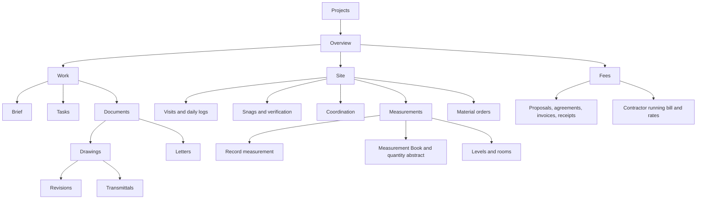

# ArchiMan UI audit and redesign plan

Date: 5 November 2026. Status: proposed implementation plan, not a shipped redesign.

### Implementation progress

First navigation/action milestone implemented on 5 November 2026:

- Project navigation now has Overview, Work, Site and Fees, with Documents and Measurements as nested hubs. The original fifteen feature pages remain reachable. Overview uses stored task/issue counts, sheets and invoice/receipt balances.
- Practice-level navigation currently ships Home, Projects and Practice. Empty Work/Site destinations were removed; the cross-project Work inbox remains a later milestone.
- Practice tools are grouped in icon-and-label rows. Project/record actions use labelled icon menus; existing deletion, review and receipt safeguards remain in the repository.
- Project screens handle Up/system Back through section and parent hubs. Per-page saveable state retains form inputs and scroll context while switching sections. Section navigation still uses saved local state inside the existing project route; full leaf routing remains future work.
- Light/dark container colors now follow the teal theme. Existing long editors and the measurement table are retained for subsequent workflow/layout milestones.

The audit and target plan below describe the baseline and full redesign; this progress note identifies the first shipped slice.

## 1. Direction

Make the app feel like a small architectural practice's daily workspace: see what needs attention, open a project, record work, review it, and collect fees. Keep the existing deep teal identity and offline data ownership. Prioritize navigation, hierarchy and form usability before visual decoration.

This audit reads the current Kotlin implementation, including the recently added record operations and backup screens. It also incorporates the phone checks from the preceding implementation work. It is not a fresh screen-by-screen device accessibility assessment or a user-research study. Findings described as risks require device verification. Older `screen-inventory.md` and `current-state-audit.md` describe an earlier build and must not be used as the current implementation inventory.

## 2. Current implementation audit

| Finding | Evidence in current source | Impact | Priority |
| --- | --- | --- | --- |
| Fifteen peer project destinations on a phone | `ProjectScaffold.kt` renders every `WorkspacePage` in one `PrimaryScrollableTabRow` | People must swipe through unrelated sections; later destinations are hard to discover | P0 |
| Two primary destinations have no useful content | `PortfolioScreen.kt` maps My Work and Site to `EmptyDestination` | The main menu promises unavailable workflows | P0 |
| Project opens on Brief | `ProjectWorkspaceScreen.kt` defaults to `WorkspacePage.BRIEF` | Returning users cannot immediately see project priorities or recent work | P1 |
| Home largely repeats Projects | `HomePane` shows practice counts and project cards | Little guidance about what to do next | P1 |
| Repeated destructive controls | `RecordActions.kt` shows Edit, Delete, Archive/Reopen or Void as peer text actions; workspace repeats project actions above each page | Important record content competes with management controls; destructive actions have excessive prominence | P0 |
| Actions appear before capability checks | Protected records still show Edit/Delete, then `ensureAllowed` reports a restriction | Users discover restrictions by attempting an operation | P1 |
| Practice navigation wraps into chips | Profile, Clients, Invoices, Demo, Portal and Backup share a `FlowRow`; registry icon metadata is not rendered by `ChoiceChip` | Administrative tools and daily registers appear equally important; positions shift | P1 |
| Lists and create forms share long pages | `ProjectPages.kt`, Drawings, Coordination and Siteman render lists followed by entry forms | Adding a record can require scrolling past existing work | P1 |
| Field entry has excessive persistent choices | Measure uses chip rows for contractors, floors, rooms and work selection | More data makes the form taller and harder to operate | P1 |
| Measurement table scrolls by individual row | `MeasurementBookScreen.kt` creates separate horizontal scroll states for rows/header | Column alignment can drift; inspection is difficult on small screens | P1 |
| Site functionality is duplicated | Siteman offers logs, HFC documents, quantity abstract, orders and calculator beside separate Drawings/Measure/M-Book screens | Users need to learn overlapping routes to the same work | P1 |
| Workflow states leak into presentation | Several views show raw status strings, underscore labels or terse transition buttons | Decisions require domain-code interpretation | P1 |
| Long editors use generic dialogs | `RecordActions.kt` builds every field with `singleLine = false`; client choices are a list of chips | Wrong keyboard behavior, tall forms and difficult scanning | P1 |
| Only two actual navigation routes | `MainActivity.kt` defines portfolio and project/id; sections use local state | Section back behavior, deep navigation and saved context need explicit design | P1 |
| Insets and accessibility need an actual device pass | Custom navigation-bar insets, mixed scrolling forms and dense tables | Potential clipping, keyboard overlap or ambiguous screen-reader order; not yet measured defects | P1 |
| Existing typography assets are not applied | `ArchiTheme.kt` uses `Typography()` despite bundled font files | Typography is not governed by a documented app scale; not itself a functional defect | P2 |
| Old documentation conflicts with implementation | Older inventory says navigation, profile editing and backup are missing | Future work may reimplement features that now exist | P1 |

Keep what works: Material 3 primitives; narrow-screen bottom navigation and wider-screen rails; grouped project rail on larger screens; light/dark teal schemes; selected navigation icons; project search and archive filters; quantity review states; backend validation and deletion safeguards. `GlassSurface` currently wraps an ordinary Card, so do not plan around expensive live blur effects.

## 3. Proposed menu structure

### Practice level: four destinations

| Destination | Purpose | Primary action |
| --- | --- | --- |
| Home | Attention queue, recent projects, outstanding fees, quick capture | Record site work → choose project |
| Projects | Search, Current/Archived/All filters and project cards | New project |
| Work | Tasks and measurement reviews across projects | Open the exact task or sheet |
| Practice | People, profile, finance register and app/data tools | Contextual action inside each register |

Remove the empty global Site destination. Site work belongs to a selected project; Home can offer a shortcut that asks for a project first. Rename My Work to Work until assignments are backed by a reliable identity model. Do not claim “assigned to me” using an arbitrary local role or unstructured assignee text.

Work replaces the current placeholder with real aggregated queries. Until those queries are implemented, ship the first navigation milestone with Home, Projects and Practice; introduce Work when its content is ready. Do not ship another renamed placeholder.

### Project level: four sections

The four project sections replace the fifteen-item phone tab row. Show only one bottom-navigation scope at a time: practice navigation outside a project, project navigation inside it. A labelled Up button returns to Projects and preserves its search/filter/scroll state. The project name remains in the header. On a wide screen, use the same hierarchy in a grouped side rail; do not invent a separate tablet vocabulary.

Secondary destinations appear in short section lists or a clearly labelled section hub, not a second permanent fifteen-item toolbar. Overview is the default project destination. Remember the last child screen during a navigation session, while a fresh project open starts at Overview.

### Practice menu groups

- **Practice:** profile and letterhead; Clients; contractor directory when the current project-only contractor management is extended to a complete register.
- **Finance:** all client invoices, with project context and links back to the invoice. Reuse one invoice detail screen.
- **Data and access:** Backup and restore; Local Wi-Fi workspace; role/account controls.
- **Help and sample data:** demo company and app information. Keep company replacement away from everyday work.

Use icon-and-label list rows grouped by headings. Move sign-out from a permanent top-right primary action into the account menu, with the current local role labelled accurately. The local role picker must not be presented as secure authentication.

## 4. Migration of every current project page

| Existing page | Proposed location |
| --- | --- |
| Brief | Work → Brief |
| Tasks | Work → Tasks |
| Letters | Work → Documents → Letters |
| Proposal | Fees → Client fees → Proposals |
| Contract | Fees → Agreements, labelled by party/type |
| Visits | Site → Visits and logs → Visits |
| Snags | Site → Issues |
| Coordination | Site → Coordination; preserve RFI/Submittal/Site instruction distinctions |
| Drawings | Work → Documents → Drawings; retain revision and transmittal history |
| Siteman | Dissolve its duplicate hub: logs/orders move to Site; HFC becomes a drawing filter; abstract moves to Measurement Book; calculator stays accessible while measuring |
| Levels | Site → Measurements → Levels and rooms; also link from project details |
| Measure | Site → Measurements → New entry |
| M-Book | Site → Measurements → Measurement Book |
| Invoice | Fees → Client fees → Invoices and receipts |
| Running bill | Fees → Contractor valuation; Rates becomes its secondary tool |

No working feature should disappear during the move. Keep a migration checklist and temporary route aliases where needed. Meetings, time, schedule and approvals are currently unlinked panes; this redesign does not automatically promote them into new menu destinations.

## 5. Icons and action hierarchy

Use the existing Material icon family. Outline for inactive navigation, filled variants for selected items where available. Use 24 dp glyphs inside at least 48 dp interactive targets. Labels stay visible on navigation and important actions. Verify each exact icon symbol against the installed dependency during implementation.

| Meaning | Suggested Material symbol | Placement |
| --- | --- | --- |
| Home / Projects / Work / Practice | Home / Apartment / Checklist / Business | Practice navigation |
| Project overview / Project work / Site / Fees | Dashboard / Assignment / Engineering / ReceiptLong | Project navigation |
| Brief / Tasks / Documents | Description / ViewKanban / FolderOpen | Section rows |
| Drawings / Letters / Revisions | Architecture / MailOutline / History | Document lists and detail sections |
| Visits / Daily logs / Snags / Coordination | EventNote / NoteAlt / ReportProblem / Forum | Site hub |
| Measure / Measurement Book / Levels / Calculator | Straighten / MenuBook / Layers / Calculate | Measurement workflow |
| Proposal / Agreement / Invoice / Receipt | RequestQuote / Handshake / ReceiptLong / Payments | Fees hub and register rows |
| Create / Edit / Save / More | Add / Edit / Save / MoreVert | Contextual actions |
| Search / Filters / Export | Search / FilterList / Share | List toolbar and export menu |
| Archive / Reopen / Delete | Archive / Unarchive / DeleteOutline | Labelled overflow menu |
| Backup / Restore / Local workspace | Backup / Restore / Wifi | Practice tools |

Avoid decorative icons on every text field. Use money/date/location icons only when they improve recognition. Icons must not communicate severity, review status or destructive intent without accompanying text.

### Replace repeated action rows

- Project card: project name, client, site, status and a trailing More menu. Tapping the card opens Overview. Menu: Edit details, Archive or Reopen based on state, then Delete separated from routine actions.
- Project header: one More menu for project-wide actions. Remove the repeated project `RecordActions` row above every child screen.
- Record row: title, useful metadata, status chip, optional primary next action and More. Keep frequent actions such as Record payment or Submit for review visible in the appropriate detail screen.
- Available actions should come from the same capability rules used by the repository. Hide inapplicable actions, or disable them with an explanation when users need to understand the rule. Keep backend checks authoritative and revalidate before writing.
- Preserve typed DELETE confirmation for whole-project removal, receipt-reversal reasons, draft protections and issue verification notes. Moving actions into a menu must not weaken these rules.

## 6. Screen layouts and interaction changes

**Home:** replace decorative practice totals with actionable rows: due tasks, sheets awaiting review and unpaid invoice balances, plus recent projects. Compute outstanding amounts from invoices and receipts, including reversals; exclude void invoices. If the relevant query or identity is absent, omit that metric rather than show invented values. A zero state says “No tasks due” with an appropriate next action.

**Project Overview:** project/client/site identity; current status; outstanding fees; open site issues; pending measurement reviews; recent records; four clear links into Work/Site/Fees/details. Do not invent a percentage-complete metric without a defined source. Keep header compact enough for useful content to be visible on a small phone.

**Lists:** separate browse and create. Use New task/New visit/New invoice in a consistent location rather than appending the create form after the whole list. Include search only where list size and lookup behavior justify it. Distinguish “No projects yet” from “No matching projects.” Display dates, units and formatted currency consistently; confirm currency from actual practice configuration rather than hardcoding a symbol into amounts with no currency model.

**Editors:** full-screen forms for project/profile/inspection/measurement; short bottom sheets or dialogs for renaming a room or recording a payment. Text keyboards for names, email/phone keyboards for contact fields and numeric keyboards for quantities/fees. Multiline only for narrative fields. Use searchable client/contractor/item selection instead of long chip lists. Provide field-level errors, busy/disabled states, visible Save/Cancel, keyboard-safe scrolling and unsaved-change handling.

**Measurement capture:** preserve contractor/item/level context in a compact header; group selection separately from dimensions; keep live quantity and unit visible near Save. Calculator opens as a supporting panel/sheet and returns a value to a clearly identified field. Expose deductions with a readable breakdown.

**Measurement Book:** phone list cards summarize sheet/item/contractor/level/status/quantity; sheet detail owns rows and review history. Use compact per-row dimension summaries on phone. On wider screens, offer a table with one shared horizontal scroll state for header and rows. Keep quantity-only records visually distinct from rates and monetary valuation.

**Fees:** distinguish architect client fees from contractor valuation. Show Amount / Received / Outstanding and a clear next action. Put original receipts and compensating reversals in a chronological history. Explain protected issued documents at their detail screen rather than displaying a failed Edit button.

**Backup:** retain the implemented file picker, preview and replacement safeguards. Present Save backup as the primary action; Restore as secondary; internal recovery as a clearly explained supporting action. Keep unencrypted-file and unavailable-attachment information visible at the decision point.

**States:** introduce reusable loading, empty, no-results, error/retry and success components. A successful save returns to the updated record with brief feedback; failed saves retain entered data. Replace raw enum strings with human-readable labels. Status uses text plus color/icon, never color alone.

## 7. Visual rules

- Retain the existing primary `#173B40`, accent `#247C80` and light surface `#F5F5F1`; retain corresponding dark-theme tokens. Verify contrast on the final surfaces. Reserve error/destructive color for actual problems and destructive decisions.
- Define spacing tokens at 4/8/12/16/24/32 dp, screen padding at 16 dp on compact layouts and 24 dp where space permits, and consistent card grouping. Avoid adding borders around every group inside another card.
- Keep Material typography as the initial baseline; document title, section heading, body, label and numeric styles. Bundled fonts are an optional later refinement after readability checks, not a reason to change every screen now.
- Use tabular or monospace digits selectively for measurements, codes and aligned amounts. Use readable text for clients, instructions and long notes.
- Prefer standard surfaces and restrained motion. Validate on the Galaxy M11; avoid blur-heavy treatments. Respect system animation preferences and support light/dark mode.

## 8. Implementation sequence

| Phase | Work | Main files | Completion gate |
| --- | --- | --- | --- |
| 1: navigation and actions | Establish four project sections, default Overview, migrate all fifteen pages, regroup Practice, replace repeated management rows with icon/label menus | `Destinations.kt`, `ProjectScaffold.kt`, `PracticeScaffold.kt`, `ProjectWorkspaceScreen.kt`, `PortfolioScreen.kt`, `RecordActions.kt` | Every current feature remains reachable; project context and Back/Up behavior are predictable; no placeholder primary destinations |
| 2: common components | Record rows, status chips, section hubs, consistent primary actions, field types and UI capability model | `ArchiTheme.kt`, new shared UI components, `RecordActions.kt`, record-policy presentation adapter | Reused on Projects, Tasks and Invoices first; deletion/reversal tests still pass |
| 3: daily workflows | Useful Home and Work aggregates, Overview queries, separate editors, contextual capture | `ViewModels.kt`, DAOs/repositories, `ProjectPages.kt`, project list/detail screens | Home → project → record → review/payment flows work with real data, including empty states |
| 4: field and financial detail | Measurement capture/book layouts, drawings/site lists, receipt history and backup presentation | Measurement screens, Siteman/Drawings/Coordination/SiteIssues panes, BackupPane | Small phone, keyboard, long names, large text and dark mode verified |
| 5: cleanup and acceptance | Remove obsolete navigation paths, replace stale documentation, accessibility and device regression pass | `MainActivity.kt`, navigation/state tests, `docs/ux/` | Full route map and current inventory agree with source and device |

These are dependency-ordered phases, not calendar estimates. Start with navigation and the shared action menu because they improve most screens without changing database schema. Home/Work aggregation requires actual query/state implementation and should not be counted as a cosmetic task.

### Navigation engineering notes

Move leaf destinations from local enum-only state into a route model that includes project and record IDs. Scope project ViewModels to the parent project graph so existing `SavedStateHandle` project IDs remain valid. Preserve filter/scroll state when returning to lists, selected child location within a session, process recreation and the system Back stack. Map existing `project/{projectId}` opens to Overview. Avoid a second independent navigation state that can disagree with the route.

Expose repository-backed record capabilities through a presentation model, rather than duplicating lifecycle rules inside menu visibility conditions. Destructive confirmations, transactions, optimistic checks, backup integrity and monetary arithmetic remain intact.

## 9. Acceptance checks

1. A new user can identify the selected practice/project context and reach any current feature without swiping a fifteen-tab strip.
2. New project → brief/task; project → site visit; project → measurement → sheet review; proposal/invoice → partial receipt/reversal; backup → preview → cancel are verified end to end.
3. Project editing/deletion is discoverable in the labelled More menu; protected records explain why an action is unavailable; project deletion still requires explicit confirmation.
4. At least 48 dp touch targets; meaningful labels for icon-only controls; logical TalkBack order and headings; status understandable without color. Verify on device rather than assuming Material defaults cover custom layouts.
5. Test 320/360/412 dp compact widths, the actual connected phone, a wider layout, 200% font scale, light/dark themes, keyboard open, long names, empty datasets, many records and rotation/process recreation.
6. No clipped navigation labels, hidden Save button, overlapping action targets, independently drifting table columns or lost unsaved input.
7. Existing JVM and isolated database/device checks pass. Add focused navigation and Compose interaction tests for the new menu/Back/editor behavior; do not treat the existing database checks as UI coverage.

## 10. Sources and evidence

Design recommendations above are judgments applied to this repository. Android's official guidance supports the underlying patterns: [layouts and navigation](https://developer.android.com/design/ui/mobile/guides/layout-and-content/layout-and-nav-patterns), [contextual overflow menus](https://developer.android.com/develop/ui/views/components/menus), and [Compose accessibility defaults and touch targets](https://developer.android.com/develop/ui/compose/accessibility/api-defaults).

Code references: `app/src/main/java/com/holagundi/archiman/ui/shell/{Destinations,ProjectScaffold,PracticeScaffold}.kt`, `PortfolioScreen.kt`, `ProjectWorkspaceScreen.kt`, `RecordActions.kt`, `ProjectPages.kt`, measurement screens, and `ui/theme/ArchiTheme.kt`. This plan preserves the operation safeguards documented in `standard-operations-audit.md` and the product direction in `product-improvement-case-study.md`.
